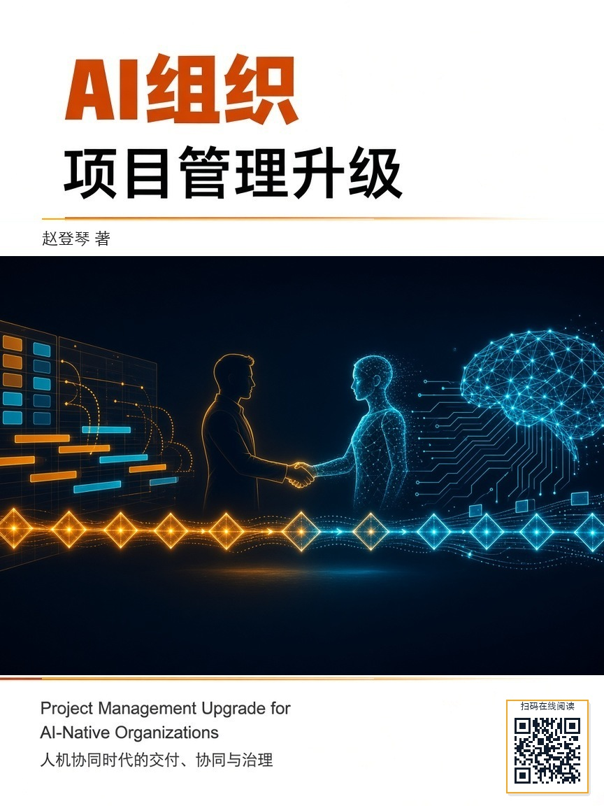

# AI组织项目管理升级

<p align="center">
  
</p>

<p align="center">
  <strong>AI组织项目管理升级</strong><br />
  人机协同时代的交付、协同与治理
</p>

<p align="center">赵登琴 著</p>

---

## 简介

当项目里同时出现业务目标、数据约束、模型迭代、流程改造与合规要求时，传统项目管理的默认假设开始失效：范围不再稳定，进度不能只靠工时堆出来，验收也不能只看“是否上线”。

本书面向希望在 **AI 组织** 中升级项目管理方式的项目经理、产研负责人与业务负责人。从「重新理解 AI 组织中的项目」出发，依次处理战略与组合、成功定义、组织与决策权、需求范围、计划交付、质量风险、跨部门协同、人效激励与落地路径，形成一套可对照真实交付场景使用的升级方法论。

**核心亮点：**

- **前言 + 10 章 + 附录** — 从认知重构到 90 天升级路线一条线打通
- **人机协同交付** — 关注责任域、双轨节奏与验证机制，而不只是排期上线
- **可验证的成功标准** — 把试点、失败与规模化写成可判定的口径
- **可执行模板** — 附录提供工具箱、决策分级与验收模板、自检与复盘表
- **配套 HTML 笔记** — 左侧手风琴目录 + 章节精读，本地浏览器即可打开

> 任何机制，如果没有人对结果负责，最终都会退化为流程。设计机制时先问一句「谁签字」。

---

## 适合谁读

| 读者 | 建议读法 |
|------|----------|
| 项目经理 / PMO | 通读，重点看第 4–8、10 章 |
| 产研负责人 / 业务负责人 | 优先读第 1–3、7、10 章 |
| 算法 / 数据 / 工程负责人 | 优先读第 4–7 章，对齐协作与验收 |
| 刚进入 AI 项目的管理者 | 先读前言与第 1、3、10 章 |

---

## 本地阅读

| 入口 | 说明 |
|------|------|
| [`cover.html`](cover.html) | 封面页（含在线阅读二维码） |
| [`index.html`](index.html) | 总目录 |
| [`ch00.html`](ch00.html) | 前言 |
| [`ch01.html`](ch01.html) ~ [`ch10.html`](ch10.html) | 各章正文 |
| [`appendix.html`](appendix.html) | 附录 |

封面右下角二维码可扫码直达 https://cltf.github.io/PMOInAINative/ 。

建议从 [`index.html`](index.html) 进入。左侧目录支持点击章节展开小节，其他章节自动收起；章内正文支持首行缩进阅读。

重新从 Word 生成 HTML：

```bash
cd 项目管理
python3 _convert_docx.py
```

> 若已对 HTML 做过手工精修，重新运行脚本会覆盖章节页，请先备份。`cover.html` 与 `images/cover.*` 默认保留，不会被脚本覆盖。

---

## 目录

0. [前言](ch00.html) — 问题、读者与全书结构  
1. [第一章 重新理解AI组织中的项目](ch01.html) — 从数字化项目到 AI 原生项目  
2. [第二章 AI时代的项目战略与组合管理](ch02.html) — 先决定做什么，再决定怎么排  
3. [第三章 重新定义项目成功](ch03.html) — 从按期上线到可验证业务结果  
4. [第四章 项目组织设计：角色、责任与决策权](ch04.html) — 编队、分工与决策台账  
5. [第五章 需求与范围：把不确定变成可管理](ch05.html) — 边界、MVP 与变更控制  
6. [第六章 计划与交付：适配AI工作方式的节奏](ch06.html) — 探索轨 / 交付轨与四条里程碑线  
7. [第七章 质量、风险与合规治理](ch07.html) — 验证、回滚与责任嵌入交付  
8. [第八章 协作机制：跨部门真正跑起来](ch08.html) — 协同界面与冲突处理  
9. [第九章 人效与激励：让团队愿意用AI交付](ch09.html) — 判断密度、评价与带教  
10. [第十章 落地路径：从试点到规模化升级](ch10.html) — 90 天计划与一年演进  
11. [附录](appendix.html) — 工具箱、模板、自检与复盘表  

---

## 作者介绍

**赵登琴** · 希望学产研团队项目经理专家，清华大学本科。  
聚焦 AI 组织中的项目战略、交付节奏与人机协同治理。

---

## 仓库说明

| 文件 / 目录 | 用途 |
|-------------|------|
| `AI 组织中项目管理升级.docx` | Word 源稿 |
| `images/cover.jpg` / `cover.png` | 封面图（右下角含在线阅读二维码） |
| `images/qr-site.png` | 站点二维码原图 |
| `cover.html` | 封面页 |
| `index.html` | 总目录 |
| `ch00.html` ~ `ch10.html` | 前言与各章 HTML |
| `appendix.html` | 附录 |
| `styles.css` | 页面基础样式 |
| `_convert_docx.py` | 从 Word 源稿生成 / 更新 HTML 的脚本 |
| `README.md` | 本说明 |

---

## License

学习研究用途。正文与封面版权归作者所有，转载或二次分发请注明出处并征得作者同意。
